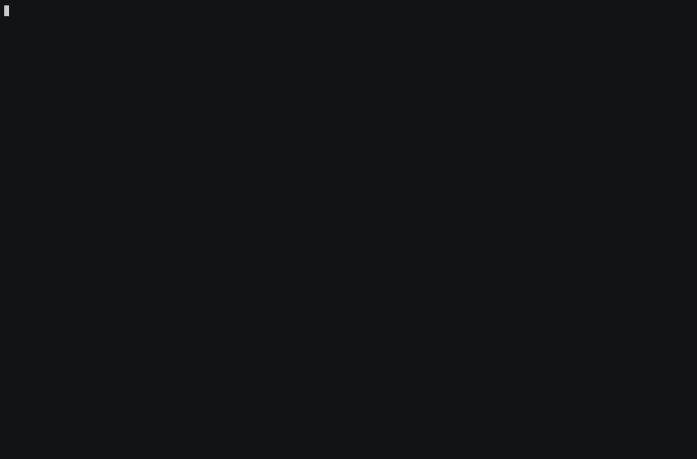

<p align="center"></p>

# balrog

A Claude Code mod that gates a feature branch before it ships.

Balrog is inspired by [kunchenguid/no-mistakes](https://github.com/kunchenguid/no-mistakes) (MIT) and borrows its shape: the step order, the disposable worktree, the `auto-fix` and `ask-user` findings, and the rule that a human decision outranks the intent. It is a separate project, not a port. A recheck step reads what the pipeline itself committed, which no-mistakes' design refuses, and hard guards on paths and commands stand where no-mistakes steers by prompt. The code is its own, TypeScript against no-mistakes' Go, and does not track its behaviour.

<p align="center"></p>

The recording above is the mod gating a toy calculator: the reviewer parks on a missing test and an unhandled zero divisor, `/balrog-fix` sends both to the fixer, the re-review, test, document, and lint steps pass, and the branch is pushed. The origin there is a local bare repository, so the PR and CI steps skip.

`/balrog [intent]` gates the current feature branch. It rebases the branch onto `origin/<default>`, then runs an adversarial review, the tests, a documentation pass, the linter, a recheck of what the pipeline itself committed, a push with a lease, a PR, and a CI watch. Every step runs in a disposable detached worktree under `~/.cache/balrog/` (mode 0700), never in your checkout. Blocking findings park the run in a pane where you fix, approve, skip, or abort. You can make the same calls from the chat with `/balrog-fix [finding ids]`, `/balrog-approve`, `/balrog-skip`, and `/balrog-abort`. `/balrog-status` reopens the pane and reports the run.

## Install

You need:

- Claude Code with mod support.
- git. Version 2.40 or newer keeps the base-attribute protection described under [Who runs what](#who-runs-what). Older git works without it.
- `gh`, logged in (`gh auth status`), for the PR and CI steps.

Add this repository as a marketplace, then install the mod from it:

```sh
claude plugin marketplace add andngu/balrog
claude plugin install balrog@balrog
```

To install from a local clone, give its path to `marketplace add` instead of `andngu/balrog`.

The install enables the mod. Check with `claude plugin list`. The entry reads `Status: ✔ enabled`. If it reads `Status: ✘ disabled`, run `claude plugin enable balrog@balrog`. Restart Claude Code to load the mod.

## Quick start

1. Check out a feature branch and commit your work.
2. Put a `.balrog.yaml` on the default branch. See [Configuration](#configuration). The mod reads it from `origin/<default>` only.
3. Run `/balrog <intent>`, where the intent says what the branch is for.
4. Watch the pane. When a step parks, act on its findings as described under [The pane](#the-pane).
5. Run `/balrog-status` to reopen the pane. It also prints the state of the last run.

## The pane

The pane is a board of the nine steps, one row each. A row holds a glyph and the step's latest fact: the command it runs, how long it has run against its 30-minute limit, the findings it parked on, the reason it was skipped or failed, or the PR as a link. A fix round reads `fix round N`. When the pipeline chose the round, after a failing CI check or a finding under `autofix`, it reads `auto-fixing (fix round N)`, and the status line says `auto-fixing` the same way. A step past 25 minutes turns to the warning colour and says when it times out. The board redraws on every state change, and every 30 seconds while a step runs.

In the terminal, a fire burns above the board while a run goes on. A balrog, horned and winged, with glowing eyes and a whip trailing to the ground, rises out of the flames over the run's first second and then stands in them. The flames move ten times a second. The fire is six rows tall and as wide as the pane. While a step is parked, it banks down to two rows of flame, so the findings keep the room. When the run ends, it dies down to two rows of dim embers that no longer move, and costs nothing more. The fire stops while the pane is closed or hidden, and goes on from the frame it had reached the next time the pane is drawn. The 30-second redraw does not restart it either, so the figure rises once per run in a session. A pane narrower than 30 columns draws no fire. The desktop app, the IDE extensions, and mobile draw the board alone.

When a step parks, the findings are listed under the board, one row each. A row shows the severity, the action (`fixable`, `your call`, or `no action`), the file and line when the agent named one, with the worktree's own path left off the file, and the first line of the description. Only the blocking findings start selected, and `[x]` marks a selected one. Press a digit, `1` to `9`, to toggle the finding it marks. A finding past the ninth has no digit, so click its row. Press `f` to send the selected findings to the fixer, `a` to approve every finding as is, `s` to skip the step, or `x` to abort. The headline above the findings says how many of the three fix rounds are left. The Fix button says how many findings it would send, or that no round is left. In the terminal, keys reach the pane only while it has the keyboard, after `ctrl+x tab` or a click, and the pane says so until then.

When the run ends, the board keeps every step's last fact. A step still running when the run ends reads `stopped`. Under the board come the outcome and what is left for you to do, each command on its own line: pull the pushed commits into your branch, remove a kept worktree, or recover or drop the commits the run pinned. When the run removes its worktree, it also removes the run directory that held it, with `rmdir`, so a directory with anything left in it stays.

### Decide from the chat

`/balrog-approve`, `/balrog-skip`, and `/balrog-abort` do what `a`, `s`, and `x` do. Approve and skip answer before the next step starts, and that step then runs in the background, as it does from the pane. An abort while a step is starting, such as a push that is still running, waits until that step settles, and the answer says so. `/balrog-fix` sends the selected findings to the fixer. `/balrog-fix r1 r2` sends exactly those findings, and they become the selection when the fix starts. Only `/balrog-fix` takes finding ids.

Each command answers in text with what it did, or why it refused. It refuses in these cases:

- There is no run, or the run already ended or is finishing.
- The step is not parked. The answer names the step and what it is doing.
- Another press or command decided the step first. The answer says the step was decided meanwhile.
- No fix round is left, or nothing is selected.
- An id is not one of the parked step's findings.
- Ids are given to a command that takes none.

In the last two cases it changes nothing.

While a step is parked, `/balrog-status` lists every finding in full: its id, severity, action, file and line, whether it is selected, and the whole description. It also says how many fix rounds are left. Once the run ends, it gives the outcome and the follow-up commands. The findings and the note reach your session as untrusted data, as the run note does. When the run has a record, the last line names the run record. A run stored by an earlier version has none.

## Run record

The mod keeps a record of the run on disk, in `<cache>/balrog/<name>-<hash>/`, where `<cache>` is `$XDG_CACHE_HOME`, or `~/.cache` when that is unset. Under it, each run has a subdirectory named for the run, and that subdirectory holds the run's worktree in `wt`.

`latest.json` holds the current run as stored. The mod rewrites it on every change of the run's state, except the bookkeeping of the paths a run agent wrote, which updates the stored run directly. `latest.json` can therefore lag that list until the next change of state.

`history.jsonl` gets one line per finished run: the final run with an `endedAt` time in milliseconds, written once its follow-ups are known. The mod appends by reading the file and writing it back whole, so a crash in the middle of that write can lose the file's tail. Every session that runs the mod on the same repository path shares `history.jsonl`. The append takes no lock, so two runs that finish at the same moment can lose one line. One session per repository is the normal case.

Both files hold agent-written text (the findings, the note) as data, so a program that reads them must treat it so. A write that fails is dropped without a word. It never fails the run or changes a step. A write that hangs is not dropped: each change of state waits for its record write to finish before its caller goes on, so a disk write that never returns stalls that caller. Changes made by other callers still reach the stored run. A run stored by an earlier version of the mod has no record directory and writes none.

### Earlier approvals

The review and the recheck read `history.jsonl` for the findings you approved as is in earlier runs of the branch, and the reviewer gets them in its prompt.

- A run counts when its repository and branch are this run's.
- From each such run they take the blocking findings of every step you approved. They never take an approval the pipeline made, a finding you sent to the fixer and did not later approve, or a step you skipped.
- The newest run comes first. A finding approved in several runs is listed once, from the newest run.
- Agents choose finding ids anew in every run, so two findings count as the same only when their step, id, file, line, and the first line of their description are all the same.
- Each listed finding is one line in the prompt: the run, the step and finding id, the severity, the file and line when it has them, and only the first line of its description, cut after 200 characters and marked with `...` when it is longer.
- At most 40 are listed, and the prompt says when the limit left some out.
- The reviewer is told that these are not decisions of this run, and to report one again only when the change makes it worse or it has evidence you did not have.
- A line that does not parse is skipped, and so is a decision that names a step its line does not hold. A history that cannot be read gives no list. Neither fails the step.
- A run stored by an earlier version has no record directory, so its reviewer gets no list.

## Who runs what

**git.** The mod runs every `git` call itself, always with `-c core.hooksPath=/dev/null -c core.fsmonitor=false -c submodule.recurse=false`, so no hook of the branch's making (a husky `core.hooksPath`, a crafted gitdir) executes. The rebase passes `--no-update-refs --no-autostash`, the push `--no-follow-tags --recurse-submodules=no`, and the fetch `--no-tags --no-recurse-submodules`, so your `rebase.updateRefs`, `rebase.autoStash`, and `push.followTags` cannot move your other branches, your stash, or your tags. It fetches only `refs/heads/<default>` and `refs/heads/<branch>`, never with `--prune`. Before any git in the worktree it checks that `<worktree>/.git` still holds what it wrote and that `git rev-parse --git-common-dir` is still your repository. Otherwise it refuses and the run fails.

**Commits.** The mod commits every change to a tracked file. Of the untracked files it commits only those at a path a pipeline agent wrote with `Write`, `Edit`, or `NotebookEdit` (that path exactly, nothing that later appears under it), minus what your ignore rules (your global `core.excludesFile` included) ignore. The path is recorded before the write runs. A write the mod cannot record is refused, and a write that a later hook or setting refuses, or that fails or throws, has its record taken back. What a configured command leaves behind (`node_modules`, `coverage`, caches) is never committed. The pane lists the mod's own commits once the push step has run, and the PR body ends with the same list. That list's stat, and the diff stat the reviewer, the fixer, and the PR body writer get, read attributes from `origin/<default>` (git 2.40 or newer), so a `-diff` the branch adds cannot show code as `Bin`.

**gh.** Every `gh` call after `gh auth status` names origin's repository with `--repo`, read from origin's URL. A PR is therefore never opened against, and CI never read from, an `upstream` remote that gh would pick on its own. An origin that names no GitHub repository skips the PR step with that reason. The PR step adopts only an open PR from origin's own `<branch>`, never a merged or closed one, or a fork's of the same name, and otherwise opens one. A failing CI check sends the fixer the failed log of the pushed head only.

**CI.** The CI step passes only when every check that ran on the pushed head passed. A skipped check counts for nothing. A repository with no Actions workflow skips the step after 2 minutes with a "no CI" reason. When workflows exist but no check ran within 5 minutes (none reported, or all skipped by path filters or by not running on pull requests), the step parks on a `ci:no-checks` finding for you to approve or abort, instead of waiting out the 30-minute timeout that parks still-pending checks.

**The reviewer.** The reviewer gets the diff in its prompt (`git diff --text`, so a `-diff` attribute in the branch cannot hide code, minus the `review.exclude` paths, which the prompt names), the `review.guide` file when one is set, the findings you approved as is in earlier runs of the branch (see [Earlier approvals](#earlier-approvals)), and `Read`, `Grep`, and `Glob` over the worktree. Nothing else. The fixer, the document agent, and the PR body writer do not get the guide or the earlier approvals.

**The recheck.** The recheck step runs the same reviewer, with the same guide and earlier approvals, over the commits the pipeline made after the review passed: the fixer's after a failing test or lint command, the document agent's, and fix rounds. It gets their subjects and their diff from the reviewed head under the same rules. With no such commit the step is skipped. A review you skipped does not skip the recheck. Its base is the head the reviewer was handed, so every commit the pipeline made since then is rechecked. When the recheck parks, you can skip it as you can any step. A run stored by an earlier version has no recheck step, so it loads with the step skipped, reason `run started before the recheck step existed`. The recheck's findings park the step as the review's do. A fix round there runs the recheck again over every commit since the reviewed head, the round's included, once the test and lint steps have run again on the round's commit. A step you approved or skipped stays as it is.

**The fixer.** The fixer gets `Read`, `Edit`, and `Write` over the worktree, and `Grep` and `Glob` too where the build registers them beside `Bash`. The native Linux build does not, so its prompt names the files the change touches. Its `Bash` runs only the configured test, lint, and format commands, spelled exactly as `cd '<worktree>' && <command>`. It has no git. The mod commits whatever it changed as soon as it answers, or once it is stopped for running 30 minutes without an answer. An agent that cannot be stopped fails the run instead, and the worktree is kept for you to remove once it ends.

**Findings.** An agent's answer ends with its findings as JSON: a fenced ```json block (the last one, which must parse). When the answer has no such block, the mod reads a bare `{"findings": [...]}` object only when the agent put a `Findings JSON:` line directly before it and the object ends the answer. Anything else, including a quoted object in the middle of prose, is not read. An answer with neither goes once to a fresh agent of the same kind (reviewer or fixer). That agent gets the answer as untrusted data and the request for the block alone. The first agent is retired, and whatever it edited is already committed, so the fresh agent redoes nothing. The first agent cannot be asked again: the host resumes a finished agent only when its type is offered to your model, and the mod hides its own. A second unreadable answer fails the run closed.

**Untrusted text.** A finding id an agent chooses must be a short slug (letters, digits, `.`, `_`, `:`, `-`; at most 32 characters), or the mod replaces it. A CI check name becomes a slugged `ci:<name>` id. These ids are the only agent- or branch-chosen text in the record of your decisions that every later prompt carries. Descriptions, check names, logs, diffs, and stats go into prompts marked as untrusted data, each inside a tag with a fresh random name, unchanged. Nothing in the data can close the tag, so nothing is rewritten to keep it shut. A run that ends before `/balrog` returns (a rebase conflict, which quotes the branch's commit subjects) hands its note back to your session the same way.

**`tool.call`.** The mod refuses every call of a pipeline agent whose step has moved on (it answered, or timed out), and of every pipeline agent once the run has ended. For the current step's agent, whatever your rules say, it refuses any read or write outside the worktree, anything at a `.git` entry (in any letter case), a write through a link that resolves nowhere, `Grep` or `Glob` without a path, a `Glob` pattern that is absolute or climbs with `..`, and any `Bash` command that is not a configured one.

**`tool.check`.** The mod consults the engine first and keeps any deny or ask that stands on your settings rules, a PreToolUse hook, or a permission setting. Only then does it allow in-worktree calls without an ask.

**The PR body.** A model writes the PR body from the intent, the diff stat, the step statuses, your decisions, and the blocking findings you approved as is. Agent-written text goes in marked as untrusted data, and informational findings stay out of it.

## Configuration

`.balrog.yaml` is read from `origin/<default>` only, never from the branch under review:

```yaml
commands:
  prepare: npm ci          # once per worktree, before the first command
  test: node add.test.mjs  # the test step; no command parks the step
  lint: npm run lint       # the lint step; no command parks the step
  format: prettier -w .    # before the push; its changes become a commit
review:
  exclude:                 # left out of the diff and stat the agents see
    - package-lock.json
    - "dist/*"
  guide: docs/REVIEW.md    # the team's standards, in the reviewer's prompt
autofix: true              # auto-fix findings go to the fixer with no press
document: false            # skip the document step; the default is true
```

### `commands`

`prepare` runs once per worktree, before the first command. After it exits 0, the mod restores every tracked file to the rebased head, so a lockfile it rewrote is put back. What it leaves untracked never reaches a commit, because the mod commits only the untracked files a run agent wrote. `test` and `lint` are the test and lint steps. A step with no command parks, since nothing ran, so nothing passed. `format` runs before the push, and its changes become a `style(balrog): format` commit.

### How the file is read

Each value is one line, plain or quoted. A quoted value (`"..."`) reads only `\"` and `\\` escapes. A block (`>-`, `|`), flow (`[...]`, `{...}`), nested or unknown key, or an unclosed quote fails the run at the rebase step with the line it could not read. Such a line never runs as a command.

A `review:` section with any key other than `exclude:` and `guide:` fails the run. So does a line at column 0 after `commands:`, `review:`, `autofix:`, or `document:` that reads as a misplaced entry: a `- item`, a command name, `exclude:`, or `guide:`. An indented line after `autofix:` or `document:` fails the run too, because the value goes on the key's own line. Earlier versions ignored these lines, so remove them from a config that has them. Any other top-level key than `autofix:` and `document:`, or a `---`, still ends the section and is ignored.

### `autofix`

`autofix: true` sends a parked step's findings to the fixer without a press when every blocking finding is one the agent marked `auto-fix` and a fix round is left. The decision is recorded as the pipeline's, the fixer gets the prompt a press would send, and the round counts against the same three. One `ask-user` finding, or no round left, parks the step as before with every finding listed, the `auto-fix` ones included. Only a plain `true` or `false` is read. An empty value, `~`, or `null` leaves it off. Anything else (`yes`, `"true"`, `[true]`) fails the run at the rebase step. The default is off.

What an automatic round does depends on the step:

- For the test and lint steps, a fix round sets the step back to pending and the command runs again. A command that still fails goes to the fixer with its output again, and a command that fails again parks on an `auto-fix` finding, so the next automatic round starts. A command that never passes therefore runs the fixer up to seven times (the fixer with the output, then three times a fix round and the fixer with the output again) and parks after the third round.
- The document step's agent is the fixer with a documentation prompt, not a reviewer. An automatic round runs it again with the stat of the whole change (`origin/<base>...HEAD`), which includes the round's commits.
- A fix round at the recheck step, automatic or pressed, also sets the test and lint steps back to pending, unless you approved or skipped them, so the round's commit is tested and linted before the recheck reads it again. A re-run command that fails sends the fixer its output again.
- The CI step fixes a failing check on its own with or without `autofix`.

In the worst case a command step therefore runs the fixer up to ten times (the seven above, plus one for each of the three recheck fix rounds), and the recheck step runs it three times. Each fixer run has the 30-minute limit, so an unattended run on a command that never passes can spend hours.

### `document`

`document: false` skips the document step, so no agent edits your docs. The step reads `skipped` with the reason `document: false in .balrog.yaml`, and the run goes on to lint. Only a plain `true` or `false` is read, as for `autofix`. An empty value, `~`, or `null` leaves the default, which is on. Anything else fails the run at the rebase step. A run stored by an earlier version has no such field and runs the document step.

### `review.exclude`

`review.exclude` keeps generated files, lockfiles, and snapshots from filling the reviewer's diff, which is cut at 120,000 characters. Each pattern is a git pathspec with git's default matching, so `*` also matches `/`: `dist/*` covers `dist/a/b.js`.

Excluded files are still rebased, tested, pushed, and readable by the reviewer, and the reviewer's prompt names the patterns. The diff and the stat the agents see leave them out. The PR body leaves them out too, because it is written from that stat and a lockfile line adds nothing to a PR description. The list of the mod's own commits at the end of the PR body still names every file. A branch that changes only excluded files still runs.

The mod does not clear git's pathspec variables. A `GIT_LITERAL_PATHSPECS` set in your environment turns every pattern off, and a `GIT_NOGLOB_PATHSPECS` turns off each pattern that has a wildcard. Neither gives a message.

The list follows the same strict rules as `commands:`: one `- <pattern>` line per item, all at one indent, each a plain or quoted value. A flow list, a scalar, a nested or unknown key, an empty item, or a pattern that starts with `:` or `-` fails the run at the rebase step. A pattern that starts with `*` must be quoted.

### `review.guide`

`review.guide` names a file of your team's review standards, such as "every migration has a down" or "no secrets in logs". The reviewer applies it as your team's standards. Your intent and the recorded decisions still outrank it. Only the reviewer gets the guide.

The value is one line: a path from the repository root, with no leading or trailing `/` and no empty, `.`, or `..` part. An empty value, `~`, or `null` sets no guide.

The mod reads the file from `origin/<default>` at the rebase step, never from the branch under review. It reads the file as git stores it, never a link's target or a textconv driver's output. The run fails at the rebase step in these cases:

- `origin/<default>` does not have the file.
- The file is over 30,000 characters, so that the guide cannot crowd out the diff.
- `origin/<default>` holds the path as a directory, a symbolic link, or a submodule.
- git reports an error while reading the file. The reason then carries git's message.

An empty file gives the reviewer an empty guide. A run stored by an earlier version has no such field and reviews without a guide.

## Trust model

What the mod runs on your behalf is not held to your permission rules or sandbox:

- The configured commands run as `sh -c <command>` in the worktree, as you, with no sandbox and your full environment (`GH_TOKEN`, cloud credentials, SSH agent). They run code the branch can change: `npm test` runs the branch's tests and `package.json` scripts, and the fixer may have edited both. Configure only commands you would run by hand on this branch.
- The mod's own `git` and `gh` calls (fetch, rebase, commit, push, `gh pr list`, `gh pr create`, `gh pr checks`, `gh run view`) run outside your permission rules, with your credentials.
- A failing test or lint command goes to the fixer with the output. The mod commits the fixer's edits and re-runs the command, and a command that still fails parks the step. Under `autofix` that park starts a fix round, the command runs again, and a command that still fails goes to the fixer with the output again, for up to three rounds. The recheck step reviews the fixer's commits before the push, after a review you skipped too. Only skipping the recheck itself leaves them unread.
- Two kinds of commit come after the recheck, and no reviewer reads them. The push step's `style(balrog): format` commit, made before the push when `commands.format` is set, holds what the repository's own configured formatter changed. The CI step's fix commits are pushed after the recheck has run.
- The `review.guide` file goes into the reviewer's prompt as is, not marked as untrusted data, because it comes from `origin/<default>`, as `commands:` does. Whoever can change the guide on the default branch can steer the reviewer, for example to let a kind of change through.
- `history.jsonl` is the mod's own cache file. The mod writes it under the cache root it keeps at mode 0700, so no other local user can change it. It holds agent-written text: the descriptions, files, and lines of the findings you approved. That text goes into the reviewer's prompt as untrusted data.
- `autofix` removes only the human press for findings the agent already marked `auto-fix`. It does not widen what the fixer can read, write, or run. After an automatic round the review step runs the reviewer again over the fixer's commits. The test and lint steps re-run their command. The document step runs its agent again with the stat of the whole change (`origin/<base>...HEAD`), which includes those commits. That agent is the fixer with a documentation prompt, and the recheck step reads its commits before the push. A fix round at the recheck step runs the test and lint commands again on its commit before the recheck reads it, unless you approved or skipped those steps.

Known limitations: hooks are off for every git call, so a `pre-push` hook such as git-lfs's does not run, and the push does not upload the branch's LFS objects. Run `git lfs push origin <branch>` yourself where the repository uses LFS. A tool output too large for the transcript may be saved by the engine outside the worktree, where the agents cannot read it.

## Development

Run the tests from the repository root:

```sh
claude plugin test .
```

The suite passes on Claude Code 2.1.306 and 2.1.307. From 2.1.307 the testing kit holds a mod's own `$.tool.call` to the `tool.check` verdict, as the host does. The mocked world therefore answers `allow` for `TaskStop`, the host's own answer. The kit has no implementation behind `$.ui.blit`, so the world answers it as the host does. A blit is taken while a test holds a terminal drawing of the pane, mounted through the world's `mountPane`, and refused otherwise.

### Layout

- `hooks/`: the mod. `register.tsx` binds the commands and guards. `io.ts` holds the bindings the run reaches the host through. `engine.ts`, `steps.ts`, `git.ts`, `guard.ts`, `prompts.ts`, `pane.tsx`, and `run.ts` hold the run. `fire.ts` draws the fire above the pane's board.
- `types/`: `index.d.ts`, the types of a run, a step, a finding, and the configured commands.
- `tests/`: the tests, run against a mocked world. `world.ts` holds that world and the helpers more than one file uses. Each `*.test.ts` file holds one area:
  - `run.test.ts`: starting a run, the rebase, the worktree, and the run directory.
  - `review.test.ts`: the review, its findings, the decisions, fix rounds under `autofix`, and the hand-over after an unreadable answer.
  - `commands.test.ts`: the test, lint, prepare, and format commands, the document step and its `document` setting, and the mod's commits.
  - `recheck.test.ts`: the recheck.
  - `push.test.ts`: the push, pr, and ci steps.
  - `pane.test.ts`: the pane, its fire, and the chat commands.
  - `guards.test.ts`: the guards, and the ownership, timeouts, and stops of run agents.
  - `config.test.ts`: the `.balrog.yaml` reader, `review.exclude`, and `review.guide`.
  - `record.test.ts`: the run record, `history.jsonl`, and earlier approvals.
- `scripts/realgit/`: checks that drive `git.ts` and `guard.ts` against real git repositories. Run `bun scripts/realgit/realgit.ts`, which runs the other three files too. Set `BALROG_MOD=<mod dir>` to drive another copy of the mod.
  - `user-config-and-checkout.ts`: the user's git config, attributes, and checkout stay out of a run.
  - `conflicts-and-commits.ts`: a conflict is not called a signing failure, a commit takes only the paths a run agent wrote, and the commit list reads the attributes of the base.
  - `stat-and-origin-url.ts`: the diff stat under a `-diff` attribute, and how origin's URL names a GitHub repository.
- `scripts/dogfood-check.sh`: checks that drive `dogfood.sh start`, `record`, and `wait` against a fake cache directory, with `tmux`, `claude`, and `git clone` replaced by stubs. Run `scripts/dogfood-check.sh`.
- `scripts/demo.sh`: records the README's demo. `setup` makes a toy repository with a local bare origin and a branch for the reviewer to park on, `record` hosts Claude Code in tmux with this checkout loaded and captures the run with asciinema, and `render` warps the quiet stretches of the cast with `scripts/demo-warp.mjs` and renders `assets/demo.gif` with agg. `all` runs the three. The hosted session spends your own Claude quota.
- `CHANGELOG.md`: one entry per release, each line naming its pull request. The version lives in `.claude-plugin/plugin.json`.
- `LICENSE`: MIT.

### Gate a branch with its own mod

To gate a branch with the mod on that branch, push the branch and run `scripts/dogfood.sh start <branch> [intent]`. The script clones the branch from `origin` into `<cache>/balrog-dogfood/<name>`, where `<cache>` is `$XDG_CACHE_HOME` or `~/.cache`, and `<name>` is the branch with every character other than a letter, digit, `_`, or `-` replaced by `-`. `feat/x` and `feat-x` therefore share a clone. It hosts Claude Code there in tmux with that clone loaded as the plugin. When you give an intent, it runs `/balrog` with it. Without an intent, `start` opens the session and stops.

The hosted session runs the branch's mod and spends your own Claude quota. It is told to stay passive, because it once reacted to the mod's notifications by editing files in the clone. `start` answers the folder-trust dialog for that clone without asking you, on purpose, so the branch's plugin and hooks run. `start` never deletes an existing clone or session. It removes only the temporary directory of a clone of its own that failed. If the session or the clone already exists, `start` stops, and you run `stop` and remove the clone by hand. The pipeline pushes its commits to the branch, so pull afterwards. The plugin loader writes an untracked `tsconfig.json` into the clone. It is harmless, and you remove the clone by hand anyway.

The other commands:

- `send <branch> <text>` clears the chat input, types the text, and presses Enter.
- `key <branch> <key>` takes exactly one tmux key name and presses it in the pane. If a one-character key lands in the chat input instead, `key` clears the input, focuses the pane with ctrl+x then Tab, and presses it once more. A second miss fails with a message. A longer key name such as `Escape` is pressed once, with no retry.
- `show <branch> [lines]` prints the screen.
- `status <branch>` runs `/balrog-status` and prints the screen.
- `stop <branch>` ends the session.
- `wait <branch> [seconds]` reads the [run record](#run-record) the hosted mod keeps for the clone, every 5 seconds, until the run ends or a step parks. It prints one line, `parked at <step>: <finding ids>` or `run <outcome>: <note>`. It exits 0 when the run passed, 1 otherwise, or 2 after the time limit. The limit is 1800 seconds, or the number of seconds given after the branch. It checks the limit after each poll, so it can overshoot the limit by up to 5 seconds.
- `record <branch>` prints the record `wait` would read, and fails with `no record for <clone> yet` when there is none.

`wait` and `record` need `jq`. Both read only a record written after your last `start`, `send`, or `key`, so they answer for that action. The record of an earlier run, or of an earlier clone at the same path, is not read, and a `wait` right after a decision does not report the step the decision just settled. An action that changes nothing, such as the `Escape` key, leaves `wait` without a verdict until its limit.
